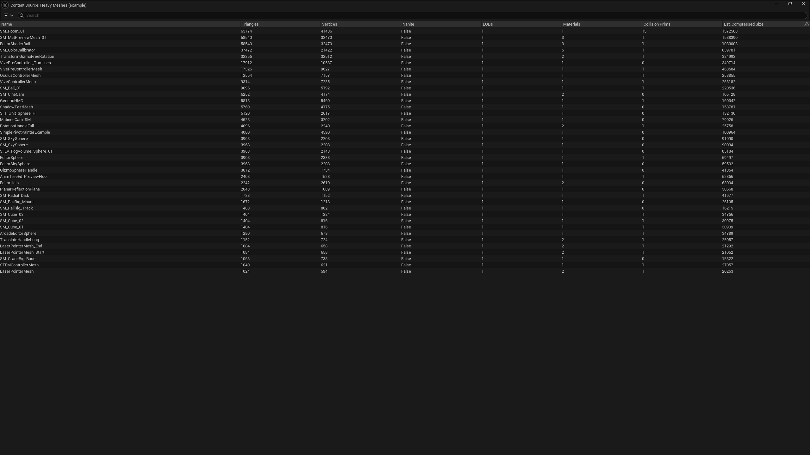

# Content Views

Data-driven tables of assets for the Unreal Engine 5.8 editor.

A **view** is an asset. It says which class's assets are the rows, which columns to show, how to sort, which filters
apply, and whether to show a list or tiles. Make a new view in the editor and you have a new way to browse your content,
with no code. Views read the asset registry only, so listing a thousand assets loads none of them.

The tab looks like the Content Browser because it is the Content Browser's own asset view: the view list on the left,
and on the right the chosen view's rows with one column per view column, sortable by any of them.

What you get:

- **Tools > Content Views**: every view asset on the left, the chosen view on the right as the stock Content
  Browser asset view, with its own columns, sort and filters. Double-click opens an asset; right-click gives the Content
  Browser's asset menu.
- **Content Browser filters**: each view is also a filter in every Content Browser's filter menu, under *Advanced > All Filters > Content Views*.
- **An MCP toolset** (`ContentViews.ContentViewsTools`) so AI agents can list views, read their typed columns and run
  them, getting rows back as JSON with each asset's path.

- **A Content Source per view** (the TEDS backend, experimental): each view as a button in the Content Browser's
  vertical source bar. It shows the view's rows in a TEDS table (or tiles) with a search box and a filter bar: the view's
  own filters, on as it opens, and a *Has <column>* filter per column. Numbers sort as numbers. A provider that finds a
  problem with an asset puts a TEDS alert on its row. New and deleted view assets add and remove their source while the
  editor runs.

**Project Settings > Plugins > Content Views > Backend** picks Legacy (the default), TEDS or Both. Both read the same
view assets; the switch applies at once. See [docs/how-it-works.md](docs/how-it-works.md).

Editor only. Nothing in this plugin reaches a cooked game.

## Install

Copy this repository into your project's `Plugins/ContentViews` folder, or pull it in with git subtree:

```
git subtree add --prefix=<Project>/Plugins/ContentViews https://github.com/ABostrom/ContentViews.git main --squash
```

Enable it for the editor only in your `.uproject`:

```json
{ "Name": "ContentViews", "Enabled": true, "TargetAllowList": [ "Editor" ] }
```

It enables two of the engine's experimental plugins: `ToolsetRegistry`, which hosts the MCP toolset, and
`EditorDataStorageFeatures` (TEDS), which the TEDS backend draws with. Rebuild your editor target.

## Quick start: the Heavy Meshes example

The plugin ships one example view, `/ContentViews/Examples/CV_HeavyMeshes` (*Heavy Meshes (example)*). Its rows are every
`UStaticMesh` in the project, and it needs no code at all, because the engine already writes each mesh's facts as
registry tags (`UStaticMesh::GetAssetRegistryTags`):

| Column | Tag | |
|---|---|---|
| Name | | |
| Triangles | `Triangles` | sorted on, highest first |
| Vertices | `Vertices` | |
| Nanite | `NaniteEnabled` | labelled through *Column Labels* |
| LODs | `LODs` | |
| Materials | `Materials` | |
| Collision Prims | `CollisionPrims` | |
| Est. Compressed Size | `EstTotalCompressedSize` | bytes, labelled |

Its filters are `Triangles >= 10000` and `NaniteEnabled = False`: the meshes that are heavy and not Nanite. The
threshold is the first filter's *Value* on the view asset. Edit it and an open view follows at once. Numbers sort as
numbers in both backends.

1. Open it: **Tools > Content Views**, then *Heavy Meshes (example)*, or `ContentViews.Open "Heavy Meshes (example)"`.
   With the TEDS backend on, it is also a button in the Content Browser's source bar.
2. Double-click a row to open the mesh. Right-click a row for the Content Browser's asset menu.
3. To make your own, duplicate the asset and change it. The rest of this page does that from scratch.



## Five-minute quick start: a view of your own class

1. **Make a field visible to the registry.** On the class whose assets you want to browse, mark the fields
   `AssetRegistrySearchable`:

   ```cpp
   UPROPERTY(EditAnywhere, BlueprintReadOnly, AssetRegistrySearchable, Category = "Stats")
   float Speed = 0.f;
   ```

   Rebuild, then resave those assets once (select them in the Content Browser, right-click, *Save*). The registry only
   learns a tag when an asset is saved.

2. **Make a view asset.** In the Content Browser: *Add > Miscellaneous > Data Asset*, pick `Content View Definition`.
   Set *Display Name*, set *Row Class* to your class, and add columns by name: `Name`, `Speed`. Pick a *Default Sort*
   (`Speed`, descending) and a *Mode* (List or Tiles). Save it under `/Game`.

3. **Open it.** *Tools > Content Views* (the main menu's Tools, its Tools section), then click your view. Or type `ContentViews.Open <view name>` in the
   console.

Your view also appears in every Content Browser's filter menu under *Advanced > All Filters > Content Views*.

Columns named `Name`, `Path`, `Plugin` and `Class` always work. Columns that need code (an average, a reverse lookup)
are small providers registered by name; see [docs/how-it-works.md](docs/how-it-works.md).

## Tests

`ContentViews.*` automation tests run in an editor: a view over a class and its Blueprint children with typed values,
every filter operator, validation, the `RunView` tool called through the toolset registry the way MCP calls it, and a new
view and an unsaved new row reaching an open tab. `ContentViews.Teds.*` checks the TEDS backend against the legacy one:
the same rows and values, a number column sorted by TEDS's own sorter, a value filter as the filter bar runs it, a
provider's alert, the backend switch, and a new view and row appearing while the editor runs. TEDS is off in
commandlets, so run them in an editor (`-ExecCmds="Automation RunTests ContentViews"`), not with `-run=`.

## Status

Both stages are built: the legacy Content Browser backend with the MCP toolset, and the TEDS backend. The TEDS backend
sits on experimental engine APIs (Content Sources, TEDS asset data, the TEDS table viewer) that change between engine
versions; it is written against Unreal Engine 5.8.4.
