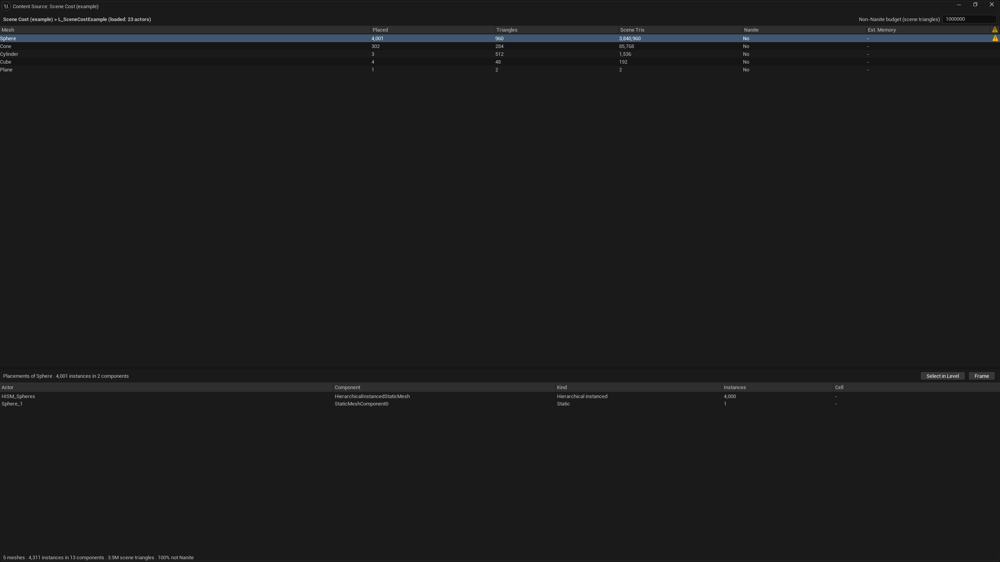
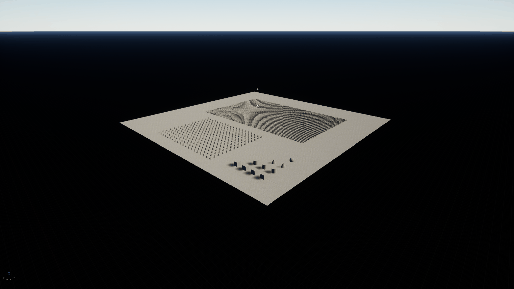

# How Content Views works

This is the engineer's tour of the plugin: what a view asset holds, where column values come from, how the legacy
backend draws a view with the stock Content Browser widgets, why nothing is loaded, what the MCP toolset returns, and
how the TEDS backend shows the same views as Content Sources, and how Scene Cost joins assets with the level open in the editor. Everything here describes code in this repository.

## The view asset

A view is a `UContentViewDefinition` (`Source/ContentViews/Public/ContentViewDefinition.h`). Every view class derives
from `UContentViewBase`, a `UPrimaryDataAsset` that holds `DisplayName` and `Icon` and has its own primary asset type,
`ContentView`. The module registers that type with the Asset Manager as editor-only, scanning `/Game`, so a cook never
takes a view. `UContentViewDefinition` is the asset archetype: its rows are assets. Scene Cost (below) is a second
archetype, `USceneCostView`, whose rows are the meshes placed in the open level.

| Field | What it does |
|---|---|
| `DisplayName` | The name in the Content Views tab, the filter menu and the MCP tools. |
| `Icon` | A brush name in the editor style set, such as `ClassIcon.Character`. |
| `RowClass` | The class whose assets are the rows (a soft class, so a Blueprint class works too). |
| `bIncludeSubclasses` | Whether assets of subclasses and Blueprint children are rows. On by default. |
| `Columns` | Column names, left to right. |
| `ColumnLabels` | A header for a column whose name does not read well (`NaniteEnabled` as *Nanite*). Others read their name in words. |
| `DefaultSort` | A column and a direction. None sorts by name. |
| `Filters` | `FContentViewFilter` rows: column, operator (`=`, `!=`, `>=`, `<=`, `contains`, `has tag`), value. A row must meet all of them. |
| `Mode` | List (a column view) or Tiles (thumbnails). |

`DisplayName` and `Icon` are themselves `AssetRegistrySearchable`, so the tab's list of views loads nothing either.

`IsDataValid` refuses an empty or missing row class, an empty column list, a column that is neither a registered
provider nor a tag any row carries, a filter that cannot run (no column, no value, a word where `>=` needs a number) and
a default sort on a column the view does not show. The same filter check, `UE::ContentViews::CheckFilter`, is what the
MCP tool refuses a bad filter with, so the editor and an agent hear the same reason.

`ToSpec()` returns the definition as a plain `FContentViewSpec` struct and `ExportJson()` writes that as JSON. Creating
a view from JSON is planned, not built.

**The shipped example.** `/ContentViews/Examples/CV_HeavyMeshes` has `UStaticMesh` as its row class. Its columns are the
engine's own mesh tags (`Triangles`, `Vertices`, `NaniteEnabled`, `LODs`, `Materials`, `CollisionPrims`,
`EstTotalCompressedSize`, all written by `UStaticMesh::GetAssetRegistryTags`). Its filters are `Triangles >= 10000` and
`NaniteEnabled = False`, and it sorts by `Triangles`, highest first. It needs no code.

## Which assets are rows

`UE::ContentViews::GatherRows` (`ContentViewQuery.cpp`) asks the asset registry for assets of the row class, plus
Blueprint assets when subclasses are included, then keeps a Blueprint only if its generated class descends from the row
class:

```cpp
FARFilter MakeRowFilter(const UClass& RowClass, bool bIncludeSubclasses)
{
	FARFilter Filter;
	Filter.ClassPaths.Add(RowClass.GetClassPathName());
	if (bIncludeSubclasses)
	{
		Filter.ClassPaths.Add(UBlueprint::StaticClass()->GetClassPathName());
	}
	Filter.bRecursiveClasses = bIncludeSubclasses;
	return Filter;
}
```

`IsRowOf` reads a Blueprint's `GeneratedClass` tag and walks its parents: a loaded class answers with `IsChildOf`, and
an unloaded Blueprint parent answers through its own asset's `ParentClass` tag. No class or asset is loaded to decide.

## Columns

A column is an `IContentViewColumn` (`Public/ContentViewColumns.h`): a function from `FAssetData` to an
`FContentViewValue`, which holds a type (string, number or bool), the value, and optionally the words to show.

**The default provider** is the registry tag of the column's name. `UE::ContentViews::ReadTag` turns the tag's text
into a value: localised text gives its words, text that parses as a number becomes a number, `True` and `False` become a
bool, and everything else is a string. An object path, or a comma list of them, keeps the full path as its value (so an
agent can act on it) and shows the object names. Five columns are built in: `Name`, `Path`, `Plugin` (the content root),
`Class` and `UsedBy`: the assets whose packages reference the row's, hard or soft, read from the registry's dependency
graph for that one row each time it is drawn or recounted, so nothing loads and no pass runs over every row.

So the cheapest column is a field marked `AssetRegistrySearchable`. A value that has to be worked out goes in the
class's `GetAssetRegistryTags`, which runs when the asset is saved:

```cpp
#if WITH_EDITOR
void UMyTeamDefinition::GetAssetRegistryTags(FAssetRegistryTagsContext Context) const
{
	Super::GetAssetRegistryTags(Context);
	Context.AddTag(FAssetRegistryTag(TEXT("Players"), FString::FromInt(Players.Num()), FAssetRegistryTag::TT_Numerical));
}
#endif
```

**A computed provider** is for a value no single asset's tags hold: an average of several tags, or a reverse lookup
across assets. Register it by name from an editor module's `StartupModule`, and unregister it in `ShutdownModule`:

```cpp
#include "ContentViewColumns.h"

UE::ContentViews::RegisterColumn(TEXT("Overall"), UE::ContentViews::MakeColumn(EContentViewValueType::Number,
	[](const FAssetData& Man)
	{
		double Sum = 0.0;
		for (const TCHAR* Rating : {TEXT("Pace"), TEXT("Strength"), TEXT("Vision")})
		{
			const FContentViewValue Value = UE::ContentViews::ReadTag(Man, Rating);
			if (!Value.bIsSet || Value.Type != EContentViewValueType::Number)
			{
				return FContentViewValue();
			}
			Sum += Value.Number;
		}
		return FContentViewValue::OfNumber(Sum / 3.0);
	},
	LOCTEXT("Overall", "The mean of his ratings.")));
```

A provider reads `FAssetData` only. If it needs another asset's facts (which team lists this player), it asks the
registry for those assets and reads their tags too. Any view can then list `Overall` like any other column.

## The legacy backend

The Content Views tab (`SContentViewsTab.cpp`) is a nomad tab with two panes. The left is a list of view assets of
every archetype from the registry (`UE::ContentViews::FindViews`, every `UContentViewBase`). For a view of another
archetype, the right pane is the widget the archetype's module registered for its class:

```cpp
// ContentViewsTeds: Scene Cost in the tab is the same widget its Content Source shows.
UE::ContentViews::RegisterViewWidget(*USceneCostView::StaticClass(), [](UContentViewBase& View) -> TSharedRef<SWidget>
{
	return SNew(SSceneCostView, FSoftObjectPath(&View));
});
```

That registry (`Public/ContentViewWidgets.h`) is how the legacy module shows Scene Cost without depending on TEDS: the
dependency runs one way, from the TEDS module to this one. A view whose class nothing registered says so in the pane.

For a view of assets, the right pane is built with `IContentBrowserSingleton::CreateAssetPicker`, the same
widget the Content Browser's asset view is made of, so it looks and behaves like the Content Browser:

- `FAssetPickerConfig::Filter` is `MakeRowFilter` for the row class.
- `OnShouldFilterAsset` does the rest per asset: `IsRowOf`, then every filter of the view.
- `CustomColumns` gets one `FAssetViewCustomColumn` per view column. Its data delegate gives the sortable text (numbers
  as numbers, with `TT_Numerical` so the column sorts numerically), its display delegate gives the words.
- Every other column is hidden: `HiddenColumnNames` for the fixed ones (class, path, size, revision control) and
  `OnAssetTagWantsToBeDisplayed` returning false for the tag columns the asset view would add on its own.
- `InitialAssetViewType` is the column view for List and the tile view for Tiles.
- The picker has no option for its starting sort, so the tab finds the picker's `SAssetView` in its widget tree and calls
  `SetSortParameters` with the view's default sort.
- Double-click opens the asset's editor (`UE::ContentViews::OpenAssets`). Right-click builds the Content Browser's
  registered `ContentBrowser.AssetContextMenu.<Class>` menu for the selection (`UE::ContentViews::MakeAssetContextMenu`,
  `Public/ContentViewAssetActions.h`), with Edit, Browse to Asset and Copy Reference in front. It passes every context
  and command list the Content Browser's own menu passes, because extenders read them unchecked. The Content Browser's
  own common section (rename, delete, duplicate) is private to it, so it is not there.

**Frontend filters.** `UContentViewsFilterExtension` is a `UContentBrowserFrontEndFilterExtension`. When a Content
Browser builds its filter list, it adds one `FFrontendFilter` per view of assets under a *Content Views* category (a
Scene Cost view lists placements, not assets, so it adds none). The filter
passes an item if it is a row of the view and meets the view's filters, so any Content Browser can show a view's
selection inside its normal folders.

## Why nothing loads

Every value comes from `FAssetData`: the registry's record of an asset, read from the package header when the editor
scans content. Rows, columns, sorting, filtering and the MCP tools all work from it. The only objects loaded are the
view assets themselves (they are small) and, when a view's row class is a Blueprint, that one class. This is why a view
over hundreds of Blueprints opens at once, and why an agent can read a table of every ability without loading any.

The cost is that a value must already be a tag. See the limits below.

## The MCP toolset

`UContentViewsTools` (`ContentViewsTools.h`) is a `UToolsetDefinition` registered with the engine's `ToolsetRegistry`
once the engine has started, the same way the engine's own editor toolsets register. The editor's MCP server then
exposes it as `ContentViews.ContentViewsTools`:

| Tool | Arguments | Returns |
|---|---|---|
| `ListViews` | none | every view's name, asset path and archetype; for a view of assets, its row class and columns |
| `DescribeView` | `view` | its columns with types, its filters, its default sort and its row count |
| `RunView` | `view`, `filters`, `sortColumn`, `bSortDescending`, `limit` | rows: `assetPath` and `values` |
| `ExportView` | `view` | the view's definition as data |

A view is named by display name, asset name or object path. Values arrive typed: an `FContentViewValueConverter`
registered with the toolset registry writes each `FContentViewValue` as a JSON number, bool, string, or `null` when the
asset has no value.

Every argument is required over MCP, even where the C++ function has a default: pass `[]`, `""`, `false` and `0` for
no filters, the default sort and all rows.

A `ListViews` call (no arguments) answers, in a project with a Levels view (one entry shown):

```json
[{"name": "Levels", "assetPath": "/Game/Editor/ContentViews/CV_Levels.CV_Levels",
  "rowClass": "/Script/MyGame.LevelDefinition", "columns": ["Name", "Plugin", "Map", "Variants", "Theme"]}]
```

A `RunView` call:

```json
{"view": "Levels", "filters": [], "sortColumn": "", "bSortDescending": false, "limit": 0}
```

answers with one row per level (two shown). `Variants` is a number, an empty reference is `null`, and a reference keeps
its full path so an agent can open or edit it:

```json
[{"assetPath": "/Level_Harbour/Data/DA_Level_Harbour.DA_Level_Harbour",
  "values": {"Name": "DA_Level_Harbour", "Plugin": "Level_Harbour", "Map": "/Level_Harbour/Maps/L_Harbour.L_Harbour",
             "Variants": 2, "Theme": "/Script/MyGame.LevelTheme'/Theme_Harbour/Data/DA_Theme_Harbour.DA_Theme_Harbour'"}},
 {"assetPath": "/Level_Roof/Data/DA_Level_Roof.DA_Level_Roof",
  "values": {"Name": "DA_Level_Roof", "Plugin": "Level_Roof", "Map": "/Level_Roof/Maps/L_Roof.L_Roof",
             "Variants": 2, "Theme": null}}]
```

A bad filter, an unknown view or a column no row carries is refused with a script error naming it.

`ListViews` lists views of every archetype. Its `archetype` field is the view's class: `ContentViewDefinition` for a
view of assets, which the tools above run, or `SceneCostView`, which the TEDS module's own toolset runs,
`ContentViewsTeds.SceneCostTools`:

| Tool | Arguments | Returns |
|---|---|---|
| `RunSceneCost` | `view`, `limit` | the level counted, its totals, the view's budget, `bCaughtUp`, and rows: `mesh`, `placed`, `triangles`, `sceneTriangles`, `bNanite`, `estMemory`, `alert` |
| `Placements` | `view`, `mesh` (object path or asset name) | each component placing the mesh: `actor` and `component` paths, `actorLabel`, `kind`, `instances`, `cell` |

Both need an editor with the TEDS backend on. `bCaughtUp` is false while a change is still waiting to be counted.

## The TEDS backend

TEDS (the editor's Typed Element Data Storage) is a column store the editor keeps beside the asset registry: rows, each
a set of typed columns, with queries, processors and widgets that read them. Its asset data feature mirrors every
asset's `FAssetData` into a row without loading the asset. The TEDS backend tags those rows with the views they belong
to, writes each view column into a typed TEDS column, and shows each view as a Content Source: a button in the Content
Browser's vertical source bar that swaps the asset view for a TEDS table.

Every TEDS call is in one module, `ContentViewsTeds`, which depends on `TypedElementFramework`, `TedsUI`, `TedsAlerts`,
`TedsAssetData`, `TedsQueryStack` and `TedsTableViewer`. The legacy module `ContentViews` never sees TEDS. When the
engine moves TEDS's API, this module is what breaks, and its tests say so.

**The switch.** `UContentViewsSettings` (Project Settings > Plugins > Content Views) holds `Backend`: Legacy (the
default), TEDS or Both. The legacy tab's menu entry and the frontend filters read it each time they are built; the TEDS
backend listens to the setting's change event and registers or removes its sources at once. The engine hides the source
bar unless `ContentBrowser.UI.ShowContentSourcesBar` is on, so the backend turns it on while it is active.

**Start.** TEDS finds every `UEditorDataStorageFactory` subclass once the editor has loaded its modules.
`UContentViewsTedsFactory` registers one processor, replaces the Content Source host widget, and starts the backend.

**Which rows belong to a view.** Each view gets a tag type of its own, generated from a template with the view's object
path as its identifier, so a query can ask for exactly that view's rows:

```cpp
State.RowTag = Storage->GenerateDynamicColumn({.TemplateType = FContentViewRowTag::StaticStruct(), .Identifier = FName(Path.ToString())});
// ...
return Select().ReadOnly<FAssetDataColumn_Experimental, FAssetNameColumn>().Where().All(RowTag).Compile();
```

Rows are tagged by the same `IsRowOf` the legacy backend uses, so a Blueprint is a row by its parent class tags.

**Nothing runs every frame over every row.** TedsAssetData stamps `FUpdatedAssetDataTag` on a row for the frame its
asset is added or changes. The backend's one processor matches only rows carrying that tag, and only notes them:

```cpp
DataStorage.RegisterQuery(
	Select(
		TEXT("Content Views: note changed asset rows"),
		FProcessor(EQueryTickPhase::DuringPhysics, DataStorage.GetQueryTickGroupName(EQueryTickGroups::Update))
			.SetExecutionMode(EExecutionMode::GameThread),
		[](IQueryContext& Context, const RowHandle* Rows)
		{
			UE::ContentViews::Teds::FBackend::Get().NoteUpdatedRows(TConstArrayView<RowHandle>(Rows, Context.GetRowCount()));
		})
	.Where()
		.All<FUpdatedAssetDataTag, FAssetDataColumn_Experimental>()
	.Compile());
```

The work is done by a cooperative task (`RegisterCooperativeUpdate`), which TEDS runs in whatever time is left in a
frame. It takes noted rows until its allowance is spent; for each it adds or removes each view's tag and writes that
view's columns. A computed column reads other assets (which teams list a player), so after any change the task also
queues every row of a view with computed columns and recomputes only those columns, within the same allowance. A new or
changed asset therefore shows its registry tag columns as soon as its row is processed, and its computed columns on the
pass after.

**Columns by name.** The same providers as the legacy backend give each value. The TEDS column depends on what the
provider says:

| Provider | TEDS column |
|---|---|
| `Name` | TedsAssetData's own `FAssetNameColumn`, drawn as the Content Browser draws a name |
| A number (declared, or a registry tag whose rows hold numbers) | `FContentViewNumberColumn` under the column's name: `double Value` with `meta=(Sortable)`, so TEDS's generated sorter sorts it as a number |
| A computed string | `FContentViewStringColumn`: the value (a path, for a reference) and the words it shows |
| Any other registry tag | the engine's `FItemStringAttributeColumn_Experimental` under the tag's name |
| A provider made with `EContentViewColumnShows::Colour` | `FContentViewColourColumn` under the column's name, drawn as a colour chip |

The number column is a template that TEDS instantiates once per column name:

```cpp
USTRUCT(meta = (EditorDataStorage_DynamicColumnTemplate))
struct FContentViewNumberColumn : public FEditorDataStorageColumn
{
	GENERATED_BODY()

	UPROPERTY(meta = (Sortable))
	double Value = 0.0;

	UPROPERTY(meta = (Searchable))
	FString Display;
};
```

A generated type's display name would read `ContentViewNumberColumn::Speed`, so the backend sets each one's
`DisplayName` to the column's header (its label, else `TeamColour` reads *Team Colour*). It registers a cell widget per
column that shows the value's words, and a header widget under its own purpose, `ContentViews.Header`, which falls back
to `General.Header`. The header makes the name column three times as wide, so names are not cut short. A colour column
used to be the stock `FSlateColorColumn`. That column's header always reads "Color" and a row can hold only one, so a
colour column is now a template of its own, like the others.

**Rows act like the Content Browser's.** A TEDS table and tile viewer bind their list's double-click and context menu to
two columns on the viewer's widget row, `FWidgetDoubleClickedColumn` and `FWidgetContextMenuColumn`. The source fills
them: double-click calls `OpenAssets` on the row's asset, and right-click calls `MakeAssetContextMenu` on the selection.
That is the same menu as the legacy tab, with every context and command list.

**Tiles keep the view's sort.** A tile viewer has no header to click, so the source puts the default sort into the
tiles' query stack: an `FRowSortNode` with the column's generated sorter, then an `FRowOrderInversionNode` when the
sort is descending.

**Alerts.** A provider that cannot give a value can say why with `FContentViewValue::OfProblem`. The TEDS backend puts
that on the row with the TEDS Alerts API, and a view with computed columns shows the alert column:

```cpp
Alerts::AddAlert(*Storage, Row, AlertName, Message, UE::Editor::DataStorage::Columns::FAlertColumnType::Warning);
```

**Filters and search.** A view's source shows an `STedsSearchBox` (it runs the view's query itself and searches the
selected columns' `Searchable` fields, which is why the query selects the name column) and an `STedsFilterBar` (with a `FilterBarIdentifier`
per view, so its state is saved) over the view's rows. The view's own filters become predicate filters, on as it opens,
and each runs the legacy backend's own test on the row's asset data, so both backends keep the same rows:

```cpp
return BuildConstQueryFunction<bool>([Store, Filter](TConstQueryContext<SingleRowInfo> Context)
{
	const FAssetDataColumn_Experimental* Asset = Store->GetColumn<FAssetDataColumn_Experimental>(Context.GetCurrentRow());
	return Asset && PassesFilter(Asset->AssetData, Filter);
});
```

Each column also gets a shape filter, *Has <column>*: a registered query for the rows whose table holds that column.

**The host widget.** The engine draws an active Content Source with the widget registered for the purpose
`ContentBrowser.AssetView`, and its own (in TedsContentBrowser) has no search box or filter bar. That purpose is unique
by name, so the factory, ordered after the engine's, registers its own: a Content View's source gets the search box,
filter bar and table or tiles; any other source gets the table the engine's host builds from that source's
`GetAssetViewInitParams`. Each view source answers `GetAssetViewInitParams` too, so the engine's host would still show
its rows and columns.

**Sources after startup.** `IContentBrowserSingleton::RegisterContentSourceFactory` can be called at any time: it
broadcasts `OnContentSourceFactoriesChanged`, and every Content Browser's source bar rebuilds. So a view asset made in
the editor gets its source at once, a deleted one loses it, and an edited one is rebuilt: its source registers again
and an open source rebuilds its table, filters and columns.

**A quick look.** `ContentViews.OpenSource <view> [width height]` opens a view's source widget, the one the Content
Browser hosts, in a window of its own.

**Experimental caveats.** TEDS, TedsAssetData and Content Sources are all experimental in Unreal Engine 5.8. The backend
uses names that say so (`FAssetDataColumn_Experimental`, `FItemStringAttributeColumn_Experimental`) and a console
variable the engine calls experimental, and the module builds with `bValidateExperimentalApi = false` because one TEDS
header does not compile with that check on. TEDS is off in commandlets, so its tests run in an editor. Asset rows arrive
over several frames after the registry's scan, so a source opened at startup fills in as they come. TEDS cells are
read-only here: an asset row holds `FAssetData`, and writing a value back would mean loading the asset.

## Scene Cost: assets joined with the open level

The Content Browser can tell you what a mesh is. It cannot tell you what the mesh costs in the level you have open:
how many times it is placed, how many triangles that puts in the scene, and whether that is a problem. Scene Cost
answers that. It is the first view of the Join archetype, rows that are assets joined with world counts, and it is
TEDS-only, because the counts come from TEDS's actor and component rows.



```
Scene Cost (example) > L_SceneCostExample (loaded: 23 actors)    Non-Nanite budget (scene triangles) [1000000]
Mesh      | Placed | Triangles | Scene Tris v | Nanite | Est. Memory | Alerts
Sphere    |  4,001 |       960 |    3,840,960 | No     | -           | over the budget of 1,000,000
Cone      |    302 |       284 |       85,768 | No     | -           |
Cylinder  |      3 |       512 |        1,536 | No     | -           |
Cube      |      4 |        48 |          192 | No     | -           |
Plane     |      1 |         2 |            2 | No     | -           |
Placements of Sphere . 4,001 instances in 2 components                    [Select in Level] [Frame]
Actor        | Component                          | Kind                   | Instances | Cell
HISM_Spheres | HierarchicalInstancedStaticMesh    | Hierarchical instanced |     4,000 | -
Sphere_1     | StaticMeshComponent0               | Static                 |         1 | -
5 meshes . 4,311 instances in 13 components . 3.9M scene triangles . 100% not Nanite
```

The capture and the block above are the plugin's example level, `/ContentViews/Examples/L_SceneCostExample`, built
from the engine's basic shapes only (no World Partition, no PCG):



- a floor (`Plane`, scaled to 60 m);
- single static mesh actors: four cubes, three cylinders, two cones and a sphere;
- `ISM_Cones`, an actor whose instanced static mesh component draws 300 cones;
- `HISM_Spheres`, an actor whose hierarchical instanced static mesh component draws 4,000 spheres;
- a movable sun, a sky atmosphere and a sky light that captures it in real time, so it renders with no lighting build.
- the engine's default World Settings (`AWorldSettings`). A project with its own `WorldSettingsClassName` swaps its class in
  when the level loads, so resave the level only from a project that uses the default, or it carries that project's class.

The 4,000 spheres and the single one put 3,840,960 triangles in the scene, and the sphere is not Nanite, so its row
passes the example view's budget of 1,000,000 and carries the alert. The engine's basic shapes carry no compressed-size
tag, so *Est. Memory* reads `-`. In a project's own level the same view counts every placed mesh.

**The view asset.** `USceneCostView` (`Source/ContentViewsTeds/Public/SceneCostView.h`) derives from `UContentViewBase`,
so it has a display name and an icon. It adds one field, `TriangleBudget`: a mesh that is not Nanite and puts more
triangles than this in the scene gets an alert. The plugin ships one, `/ContentViews/Examples/CV_SceneCost`. Each Scene
Cost view is a Content Source, like an asset view.

**Placements come from component rows.** TEDS keeps a row for every actor and component in an editor world
(TedsActorCompatibility registers an actor's components once the actor's row syncs). A row carries
`FTypedElementSyncFromWorldTag` for one frame when its object is added, loaded or modified. One processor matches rows
with that tag, keeps the static mesh components, and only notes them:

```cpp
DataStorage.RegisterQuery(
	Select(
		TEXT("Content Views: note synced static mesh components"),
		FProcessor(EQueryTickPhase::DuringPhysics, DataStorage.GetQueryTickGroupName(EQueryTickGroups::Update))
			.SetExecutionMode(EExecutionMode::GameThread),
		[](IQueryContext& Context, const RowHandle* Rows, const FTypedElementUObjectColumn* Objects)
		{
			// ... Cast<UStaticMeshComponent>(Objects[Index].Object.Get()) ...
			Backend.NoteComponentRows(Components);
		})
	.Where()
		.All<FTypedElementSyncFromWorldTag>()
	.Compile());
```

The backend's cooperative task (the same `RegisterCooperativeUpdate` task as the asset rows) reads each noted
component and writes an `FContentViewPlacementColumn` on its row: the mesh, the instances it draws (an instanced or
hierarchical instanced component's instance count, else 1), the world and the owning actor. It removes the column when
the component no longer places a mesh in an editor world. An observer on that column's removal notes when a component
row goes away, for example when the actor is deleted, its cell unloads, or garbage collection runs:

```cpp
DataStorage.RegisterQuery(
	Select(
		TEXT("Content Views: a placement went"),
		FObserver::OnRemove<FContentViewPlacementColumn>().SetExecutionMode(EExecutionMode::GameThread),
		[](IQueryContext& Context, RowHandle Row, const FContentViewPlacementColumn& Placement)
		{
			UE::ContentViews::Teds::FBackend::Get().NoteSceneChanged();
		})
	.Compile());
```

**The one registration TEDS needed.** An instanced component's instance count can change with no sync tag. PCG adds
and clears instances with `AddInstances` and `ClearInstances`, which do not call `Modify`. A component PCG creates
mid-generation can also miss the engine's own component registration, which runs on the owning actor's row. The engine
does report every instance change through `FInstancedStaticMeshDelegates::OnInstanceIndexUpdated`. The backend listens
to that delegate for editor worlds. On the next cooperative pass it notes the component's row, or registers the
component with TEDS's compatibility layer (`AddCompatibleObjectExplicit`) if it has no row yet. This is the same call
the engine uses for an actor's components. The new row arrives with the sync tag, and the processor picks it up. This
is what keeps the count right while PCG regenerates.

**Counting is gated.** Nothing scans every row each frame. A count runs only when something changed: a placement
column was written or removed, a level actor was added or deleted (`UEngine::OnLevelActorAdded` and
`OnLevelActorDeleted`), the map or a streamed level changed, or the view's budget was edited. It waits 0.1 s after the
last change, so a burst (a PCG cell writing hundreds of components) counts once. The count runs one query over the
placement columns, sums each mesh's instances in the open level's world, and leaves out an actor that is already
deleted (its component rows stay until garbage collection). When the first Scene Cost view is built, or the map
changes, the backend looks at each component row once, because rows that synced before were not noted.

**The join.** Each counted mesh is looked up in TedsAssetData's own rows, through the `Asset` mapping domain:

```cpp
const RowHandle AssetRow = Storage.LookupMappedRow(UE::Editor::AssetData::MappingDomain, FMapKey(Path));
const FAssetDataColumn_Experimental* Column = Storage.GetColumn<FAssetDataColumn_Experimental>(AssetRow);
```

Its facts come from the registry tags on that row. *Triangles* is `NaniteTriangles` for a Nanite mesh and `Triangles`
(LOD 0) otherwise. *Est. Memory* is `EstNaniteCompressedSize` or `EstTotalCompressedSize`. When a tag is missing, the
loaded mesh answers. *Scene Tris* is *Placed* x *Triangles*.

**Rows and columns.** Each Scene Cost view's rows are TEDS rows in a table of their own (`ContentViews_SceneMeshes`),
one per placed mesh, tagged with the view's own dynamic tag. Their columns are the same templates the asset views use:
`FContentViewStringColumn` for *Mesh* and *Nanite*, and `FContentViewNumberColumn` for *Placed*, *Triangles*,
*Scene Tris* and *Est. Memory*. So they sort as numbers with TEDS's own sorter and draw with the same cells and
headers. The table opens sorted by *Scene Tris*, highest first. An over-budget mesh gets a TEDS alert through
`Alerts::AddAlert`, with the scene triangles and the budget in its message, in the stock alert column.

**The widget** (`SSceneCostView`). The top bar names the level being counted and its loaded actor count, and holds the
budget, which edits the view asset in a transaction. The table is an `STedsTableViewer`. A mesh row opens its mesh on
double-click and gives the asset menu on right-click. Selecting a row lists that mesh's placements below: actor, component,
kind (static, instanced, hierarchical instanced), instances, and the World Partition grid the actor streams in (or
*Always loaded*; `-` in a level without World Partition). Two buttons work on those placements. *Select in Level*
selects their actors. *Frame* moves the level viewports to them. The status line gives the totals: meshes, instances,
components, scene triangles, and the share that is not Nanite. With nothing selected, the costliest mesh is listed.

`ContentViews.SceneCost.Dump [rows]` logs the totals and each Scene Cost view's first rows, for agents and for logs.
`ContentViews.OpenSource "Scene Cost (example)" [w h]` opens the widget in its own window.

**Limits.** It counts static mesh components (plain, instanced, hierarchical instanced) in the editor world: the level
open in the editor and its loaded sublevels and cells. Unloaded World Partition cells are not counted. Neither are
skeletal meshes, landscape, foliage painted through the foliage tool's own instancer, or instanced actors. A Nanite
mesh is counted at its Nanite triangle count, which is its source detail, not what renders at a given distance. The
budget alerts only on meshes that are not Nanite. The archetype is built as this one view; a generic Join base, for
example materials by placed use, is not extracted yet.

**Why both backends read one asset.** A view is a description of a table, not of a widget. Keeping rows, columns,
sort and filters in one data asset means a view made for one backend works in the other, and the MCP
tools, the frontend filters and either backend all agree on what a view is.

## Limits

- **Tags need a resave.** A tag exists only once an asset has been saved by code that writes it. After adding
  `AssetRegistrySearchable` or a `GetAssetRegistryTags` entry, resave the assets once (a Blueprint's tags come from its
  class default, so resave the Blueprint).
- **Tags are text.** The registry stores every tag as text. The default provider types a value by reading it (numeric
  text becomes a number), and a column's type in `DescribeView` is the type most of its rows hold. A provider that
  declares a type always returns that type.
- **Editor only.** The module is `Type: Editor` with `TargetAllowList: ["Editor"]`. Registry tags written in
  `GetAssetRegistryTags` should sit under `WITH_EDITOR` in runtime classes.
- **A computed column shadows a tag.** A registered column answers for its name in every view, so a registry tag of the
  same name can no longer be read as a column. Name computed columns for what they compute.
- **Tiles show names.** In Tiles mode the asset view shows each row's thumbnail and name; the other columns show in List.
- **Stock menu, not all of it.** The right-click menu has the Content Browser's registered entries and three of its
  own, not the Content Browser's private common section.
